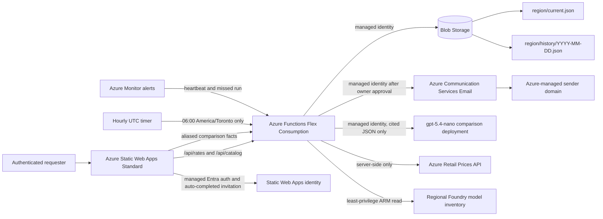

# Foundry Cost Lab

Foundry Cost Lab is a provenance-aware Azure AI cost modeller for customer-facing architecture sessions. It separates monthly estimates into Run, Guardrail, Platform, and Change tiers, keeps missing rates visibly unpriced, and records the rate-card date used for every export.

The output is a planning estimate, not a commercial quote.

All figures use native CAD retail prices returned by Azure's Retail Prices API. The application does not convert USD values or apply an exchange-rate assumption.

## Agent cost coverage

- Foundry hosted-agent runtime is modeled from vCPU-hours and GiB-hours across active sessions. Billed minutes include processing and the configured idle window; these usage lines do not scale with environment count.
- Agent tools are independent cost blocks: Code Interpreter sessions, File Search GB-days, Foundry skills execution hours, and Web Search grounding requests.
- Foundry Standard Agent Setup includes customer-managed Cosmos DB thread storage, Azure AI Search vector stores, and Hot ZRS Blob Storage for files, chunks, and embeddings.
- Cosmos DB supports provisioned throughput, with the documented 3,000 RU/s project minimum, or serverless request-unit modeling. Dedicated Search Units, semantic ranker, agentic retrieval reasoning, planner-model tokens, image extraction, Custom Entity Lookup, and embedding-model tokens are separate dimensions.
- Observability covers Analytics Logs ingestion, billable retention, archive, export, and 15-minute log alerts. Networking covers Private Link data processing, NAT Gateway, Azure Firewall Basic, and internet egress.
- Disaster recovery is service-specific across PTUs, API Management, Search Units, Cosmos throughput, Blob capacity, private endpoints, application compute, and inter-region traffic. Enabling it replaces the legacy blanket secondary-region multiplier.
- These are planning allocations only. The calculator's `infra/` deployment does not provision a customer's Foundry, Cosmos DB, AI Search, or agent file-storage resources.

## Foundry catalog coverage

- Every Toronto morning, the Function queries the supported `Microsoft.CognitiveServices/locations/models` ARM endpoint for Canada Central, Canada East, East US, and East US 2, normalizes unique model versions, and promotes dated regional snapshots only when the result is non-empty.
- The UI merges that live regional inventory with a dated 150-entry full-provider snapshot. Regional entries are labelled `regional`; entries absent from ARM remain visibly snapshot-backed instead of being presented as freshly verified.
- Models are searchable under **Direct from Azure**, **Foundry Labs**, **Hugging Face**, and **Fireworks on Foundry**. Catalog presence does not assert regional quota, subscription eligibility, or Marketplace acceptance.
- Model selection uses progressive disclosure: users first choose **Pay per use** or **Dedicated endpoint**, then see a five-model shortlist and search. Provider/use-case filters, deployment SKU, and fallback pricing remain collapsed until requested.
- Token API models use input/output token volume. Hugging Face managed-compute models use instance-hours. Image, audio, embedding, scientific, and other modalities use an explicit native usage quantity.
- Dedicated endpoints expose availability, instance count, monthly hours, VM hourly rate, and an immediate CAD compute estimate. Existing scenario fields and exports remain unchanged.
- Model and deployment SKU form one pricing key. Global Standard, Data Zone Standard, Regional Standard, Global/Data Zone Batch, Global/Data Zone/Regional Provisioned, Developer, Marketplace, and managed-compute selections never inherit another SKU's fallback.
- The current exact GPT-4o mappings cover Global Standard input/cached-input/output, Global Batch input/output, and Global Provisioned PTU plus PAYG overflow. Unsupported model/SKU combinations remain unpriced.
- Approved Marketplace, private-offer, or managed-compute rates can be saved as a source- and date-stamped scenario profile for exactly one model/SKU. Verified native CAD rate-card values always take precedence over that profile.
- The results view shows the selected processing boundary, every required rate dimension, Retail versus fallback coverage, and approval blockers. A catalog entry is never represented as a priced deployment.
- The Run configuration also includes 18 dated service definitions across Content Understanding, Speech, Translation, and Language. Their definition date is visible in the UI; each service has an independent usage quantity and rate.
- The catalog is discovery and cost-planning metadata; this application does not create the customer model deployments being estimated. Their availability must be confirmed against the target subscription, region, quota, and provider terms. The small comparison model described below is a separate internal utility.

Guided setup starts with no selected use case, monetary estimate, or pricing-completeness claim. The draft preview begins after the first explicit use-case choice; **Start over** and **Reset workspace** return to the empty guide. Regional rates and catalog data load for the draft's selected region, including region changes inferred from reviewed notes. While either request is pending, the started preview shows **Pending** and **Apply estimate** is disabled. Applying reuses the reviewed datasets without fetching new prices; skipping leaves the saved configuration unchanged. PDF export and scenario actions remain available in the applied calculator view. Failed requests retain the existing, explicitly labelled regional fallback behavior.

## Calculator experience

The plain homepage opens an empty guided setup on every visit and page refresh, including for returning users who previously completed or skipped setup. Sign-in, access approval, and any legacy-workspace ownership choice still come first. **Skip to calculator** restores the saved configuration without changing it; **Apply estimate** replaces it only after review. Saved scenarios and revisions are retained. The existing `?guide=1` link remains supported but is no longer required.

- The calculator's **Delivery stage** selector changes only the POC/Production label, not workload, models, purchase mode, provisioned capacity, service selections, or environments. **Skip to calculator** preserves the current configuration. Costs change when their underlying inputs change; a Production label does not certify readiness or imply any service is provisioned. Guided setup continues to create a separate, reviewable draft. Existing saved high-capacity designs are preserved; to remove their PTU charges, deliberately select a usage-based deployment SKU and review secondary PTUs under Disaster recovery, or use the confirmed workspace reset to start fresh.
- On phones and tablets up to 860px, **Configure** and **Results** are separate views with a persistent CAD estimate and **Review pricing** action. Switching views preserves inputs and the selected cost tier. Desktop retains the two-pane workspace.
- Results lead with known unit costs, the three largest priced contributors, and tier totals. Cost drivers and unpriced or last-known items open their owning configuration section with keyboard focus. Model rate details and projection/capacity/history are expandable; modeled spend is not presented as observed billing.
- Guided review exposes editable workload assumptions with **Preset**, **From note**, or **Edited** labels and a reset action. Earlier setup selections remain available in a disclosure. Applying focuses the results and preserves the reviewed regional datasets.
- Undo and redo cover calculator edits, presets, applied drafts, and scenario loads. A focused field edit is one history entry. History is capped at 50 entries, stays in memory, and does not change saved scenarios or persist across reloads.
- Page refresh preserves saved calculator work. The header **Reset workspace** icon opens a confirmation before deleting this browser's estimate, rate profiles, saved scenarios, comparison summaries, selections, and undo/redo history. Confirming reopens guided setup at the first step with an empty current-month configuration: usage and capacity inputs are zero and all services are off. **Skip to calculator** retains this empty, zero-cost state, including after reload; sample assumptions return only when a user applies a guided estimate. Required region, month, and single-environment settings remain valid. Cancel or Escape keeps everything. Reset does not affect sign-in, display preferences, downloaded exports, or Azure rate/catalog data, and does not reset server-side usage limits. Browser-storage failures are reported instead of claiming that persisted data was deleted.
- Data-source notices are consolidated without hiding active unpriced or last-known warnings. The mobile estimate uses compact notation for large amounts; full values remain in Results and exports.
- PDF exports include workload evidence, the calculation version, and traffic planning bounds. JSON exports include an immutable original revision. Protected sharing and server-side scenario versioning are not implemented.

## Decision evidence and estimate revisions

- **Planning range and sensitivity** varies monthly users around the base workload by a user-selected percentage (initially 20%). Token sizes, independently entered service quantities, and capacity remain fixed. These are traffic planning bounds, not confidence intervals or complete TCO forecasts. The three largest one-input sensitivities are ranked by known cost movement; primary cache variation uses percentage points and active days are capped at 31. Missing and last-known price warnings remain visible.
- **Workload evidence** records a non-sensitive measurement reference and observation dates. Recording the current workload is a user attestation, not independent telemetry verification. It covers workload inputs, agent turns including retries, harness overhead, model routing, and cache rates. Changing those inputs marks the evidence as needing review. Successful tasks per month is an independent optional outcome count; it is never inferred from users or turns.
- Pricing completeness, workload evidence, and deployment validation are separate. Deployment remains **Not validated**; monthly PTU allocation does not establish peak throughput, latency, quota, regional eligibility, or production readiness. Comparison lists selected optional guardrail services rather than presenting their count as a security score.
- Scenario comparison exposes changed configuration inputs, including requests, tokens, cache settings, and service quantities. Differing workload inputs produce a like-for-like comparison warning in both the deterministic view and the facts available to the optional summary.
- **Save current** appends an immutable revision when the scenario name already exists. A revision includes the input configuration, original result and line provenance, full regional rate card, selected model metadata, timestamp, and calculation version. **Review original revisions** opens the archived estimate without recalculation. **Reprice** separately shows current regional pricing and attributes known-subtotal movement to rates, calculation version, and catalog changes with no workload edits. Loading inputs opens a working copy at current prices; it does not overwrite the archive.
- Schema-v2 JSON preserves the original revision; legacy schema-v1 files remain importable as inputs only. Imported archives are structurally checked but are not digitally signed. **Backup workspace** includes current inputs and all saved scenarios and revisions. Import validates the whole backup before restoring it, keeps existing scenarios, and assigns distinct names to collisions. Browser quota failures switch to an explicit in-memory mode; download a backup before leaving that session.
- Before restoring a production workspace, the app verifies the current `costlab-user` through `/.auth/me`. Workspace, guide, and comparison-cache keys are scoped to a SHA-256 identifier of the authentication provider and user ID. Foreground checks preserve the UI for the same account and lock/reload it if identity is lost or changed. Local loopback development retains its existing browser-wide workspace.
- Legacy browser-wide estimates are never silently assigned to a signed-in account. Users can start separately or explicitly import their legacy workspace. The legacy estimate and cache copies are removed only after successful browser-backed restoration. Account-scoped reset leaves other accounts and unclaimed legacy data untouched.
- Local data remains until deletion or reset; sign-out does not erase it. Account separation is not encryption and does not protect against another person with browser-profile or developer-tool access. Backups can contain private rates and must be handled accordingly. No cloud sharing, automatic telemetry ingestion, encryption, or deployment verification was added.

The calculation version is defined in `web/src/domain/estimateRevision.ts`. Increment it when billing formulas change; do not rewrite archived results to match a newer engine.

## Scenario comparison

- Select exactly two or three saved scenarios in **Scenarios**, then open the dedicated comparison workspace. A fourth selection is blocked in both current and migrated browser state.
- Every scenario is recalculated against the current rate card and catalog for its own saved region. The comparison never reuses a different scenario's totals or treats an unpriced line as zero.
- The deterministic scorecard shows known monthly and annual subtotal, delta from the selected baseline, cost per monthly user, cost per 1,000 agent turns, pricing completeness, selected guardrail services, private networking, disaster recovery, tier distribution, top line-item drivers, and changed assumptions.
- The workspace presents one neutral customer view with a selectable comparison baseline. Internal buyer and competitor selectors are not exposed in customer conversations.
- “Lowest known subtotal” is used instead of “winner” whenever pricing coverage differs. Missing implementation effort, migration, commitments, data gravity, operational labour, and business outcome evidence remain explicit discovery items.

### Optional grounded brief

The comparison remains fully usable without AI. When enabled, **Generate summary** asks a dedicated `gpt-5.4-nano` deployment to turn deterministic facts into a concise decision summary; it does not calculate totals or choose the recommended scenario.

- The browser sends aliases `A`, `B`, and `C` and at most 24 bounded facts. Scenario names and complete saved configurations never leave the browser.
- The API treats fact text as untrusted data, requires schema-constrained JSON, rejects unknown citations, and requires citations for the summary, strengths, and trade-offs. Generated wording is instructed to avoid internal sales or lens terminology.
- The model is keyless: local account authentication is disabled and the Function user-assigned identity has `Cognitive Services OpenAI User` only on the comparison model account.
- Per-user usage is SHA-256 keyed and limited to 20 generations per UTC day in private Blob Storage. Summaries are cached best-effort in the user's browser by their aliased facts.
- The East US 2 deployment uses GA `gpt-5.4-nano` `2026-03-17`, Global Standard, at 10K TPM. With native CAD Retail rates of `$0.2818/million` input tokens and `$1.7613/million` output tokens, a planning envelope of 3K input plus the enforced 1,000-completion-token cap is about CAD `$0.00261` per brief, `$0.0521` at one user's daily limit, or `$1.56` if that user exhausts the limit every day for 30 days. Reasoning effort is disabled for this extraction-style task.

## Architecture



The browser never calls an external pricing or ARM endpoint. Failed synchronization preserves each last-good `current.json`; zero-meter and zero-model results cannot promote a snapshot. `/api/health` reports all four regions and returns `503` when any rate or catalog snapshot is missing or more than 36 hours old.

## Installable mobile app

Foundry Cost Lab is an installable Progressive Web App (PWA). It uses the existing Static Web Apps deployment and adds no Azure resource or material Azure consumption.

- On supported Chromium browsers, use the download icon in the header or the browser's **Install app** action.
- On iPhone and iPad, open the site in Safari and use **Share → Add to Home Screen**. Apple does not expose a programmable install prompt.
- The installed app uses the Microsoft four-pane icon, opens in standalone mode, and retains the same managed Entra `costlab-user` requirement.
- A refresh icon appears when a new service-worker version is ready; applying it reloads the current release.
- Only versioned JavaScript, CSS, theme, icon, and manifest assets are precached. HTML navigation, `/api/*`, and `/.auth/*` remain network-only and are never stored by the service worker, so installation does not bypass authentication.
- PDF generation libraries are loaded only when Export PDF is selected and are excluded from PWA installation precache.
- A network connection is required to launch and authenticate. This is intentionally not an offline copy of protected scenarios or pricing data.

## Repository

| Path | Purpose |
|---|---|
| `web/` | React 18, TypeScript, Vite, Zustand, Radix, and Recharts client |
| `api/` | Node.js 22 Azure Functions v4 API and scheduled rate sync |
| `infra/` | Pinned Azure Verified Module composition for `azd` |
| `.azure/deployment-plan.md` | Deployment workflow source of truth |

## Local development

Prerequisites: Node.js 22+, npm, and optionally Azure Functions Core Tools plus Azurite for the API host.

```powershell
Set-Location web
npm ci
npm run dev -- --host 127.0.0.1
```

The client runs at `http://127.0.0.1:5173/`. By default, Vite serves the dated built-in CAD rate card and model catalog through local `/api` bridges, so local development does not produce API 404s.

### Live local rates and catalog

The production timer refreshes at 06:00 Toronto time. For an immediate local refresh, sign in with Azure CLI and run the same production synchronizers on demand:

```powershell
$env:AZURE_SUBSCRIPTION_ID = az account show --query id --output tsv
npm --prefix api run sync:local
```

This writes current and dated history snapshots under `api/data/`.

The existing Vite development server detects those files on the next API request; reload `http://127.0.0.1:5173/` and the header changes to **Synced rates**. No Vite restart or Functions host is required for this normal local workflow.

To test the complete Azure Functions host as well, start Azurite and Functions in separate terminals:

```powershell
Set-Location api
npx --yes azurite --silent --location .azurite
```

```powershell
Set-Location api
$env:AzureWebJobsStorage = 'UseDevelopmentStorage=true'
$env:FUNCTIONS_WORKER_RUNTIME = 'node'
$env:AZURE_FUNCTIONS_ENVIRONMENT = 'Development'
npx --yes --package azure-functions-core-tools@4 func start --port 7071
```

Then restart Vite after setting the proxy target; the variable is read only at startup:

```powershell
$env:LOCAL_FUNCTIONS_URL = 'http://127.0.0.1:7071'
npm --prefix web run dev -- --host 127.0.0.1
```

Confirm the full Function-host path with `Invoke-RestMethod http://127.0.0.1:7071/api/health`. Re-run `npm --prefix api run sync:local -- --region=eastus` whenever an immediate active-region refresh is needed. Omit `--region` to refresh all four supported regions; add `--rates-only` or `--catalog-only` to limit the operation. Deployed Azure runs both automatically each Toronto morning.

For the API:

```powershell
Set-Location api
npm ci
Copy-Item local.settings.example.json local.settings.json
npm start
```

When `RATE_STORAGE_ACCOUNT_URL` is empty, the API uses `api/data/` for local rate and catalog history. Set `AZURE_SUBSCRIPTION_ID` to test live regional catalog synchronization. Azure uses managed identity and Blob Storage.

## Verification

```powershell
Set-Location web
npm test
npm run lint
npm run build
npm run test:e2e
npm run test:pwa

Set-Location ..\api
npm test
npm run build
npm audit
```

Release validation on September 8, 2026: 117 web unit/property tests, 83 API tests, 48 application workflows, and 3 production PWA device profiles pass. Browser coverage includes automatic invitation completion, requester/approver access flows, desktop, Android, iPhone-sized metadata/layout, PDF/JSON downloads, mobile installation, secure offline cache boundaries, four-region isolation, model/SKU profile isolation, all five technical pricing domains, three-scenario comparison, aliased AI facts, reset persistence, explicit Sentinel usage, stage-change preservation, and responsive/accessibility checks. Both builds and linters pass. Web and API dependency audits report zero vulnerabilities after the release toolchain updates.

## Rate policy

- Sentinel is optional and disabled in new POC and Production estimates. Enabling it requires an explicit **Billable monthly ingestion** value under **Guardrail > Microsoft Sentinel**: blank means usage required, while an explicit zero means no billable ingestion. No volume is inferred from users or production stage. Existing saved/imported scenarios keep their entered values, including previous preset allocations; edit or disable those deliberately. The simplified PAYG meter includes ingestion and Sentinel analysis, so the same data should not be charged again as observability ingestion. Enter the workload's allocation after eligible free data and benefits; commitment pricing is not modeled.
- Synced GPT-4o token/SKU meters, hosted-agent runtime, Code Interpreter, File Search, skills execution, Search premium features, Sentinel, API Management, AI Search, Cosmos DB, Blob Storage, observability, Private Link, NAT Gateway, Azure Firewall Basic, and supported inter-region transfer are normalized from named Azure Retail Prices API meters.
- GPT-5.4-mini `2026-03-17` Global Standard input, cached-input, and output use exact `Azure OpenAI GPT5` Consumption meters, scoped to the requested region and the catalog's model/version/SKU keys. Their `1M` prices pass through unchanged; legacy `1K` prices are multiplied by 1,000. Batch, Data Zone, priority, Regional, and Provisioned offers do not inherit these prices. The September 7, 2026 Retail query returned CAD 1.0395 / 0.1040 / 6.2372 per million input / cached-input / output tokens in Canada East, East US, and East US 2; no matching Canada Central meters were returned. These are reference budget prices, not invoice or deployment-availability guarantees.
- Manual model rates are scoped to one model/SKU, visually distinct, and carry their offer source and as-of date.
- Unmatched or ambiguous services without a previous price remain `null` and appear as **Unpriced**. A previous Retail value is retained with its original date and shown as **Last-known**, not as a newly verified match. Known subtotals never imply completeness.
- Each sync records per-rate verification status, check time, and a failure reason when applicable. Conflicting equally preferred meter identities or prices are rejected regardless of response order; identical duplicates are accepted. Zero verified matches still prevent snapshot promotion.
- Last-known price warnings appear in guided setup, the estimate, pricing readiness, source details, scenario comparison facts, and PDF/JSON exports. They block pricing readiness without erasing the retained amounts. Older snapshots are supported using their unmatched keys and per-rate dates; intentional manual prices remain separate.
- Regional internet egress uses each region's exact Microsoft Global Network CAD tiers, including the first 100 GB at `$0`; it is not flattened into one rate.
- Private Link endpoint-hours use the exact global CAD meter. Private Link data processing is a separate usage dimension.
- Azure AI Search S1 uses each region's exact CAD unit meter. Canada East publishes `Standard S1 Unit` at CAD `$0.4734/hour`.
- Canada East has no availability zones, so Standard Agent Setup file storage is priced and labelled as Hot LRS there. Canada Central, East US, and East US 2 use their exact regional Hot ZRS meters. The UI surfaces the lower Canada East resilience rather than treating LRS as equivalent to ZRS.
- Internal tenant members do not consume External ID MAU. Guest/external MAU is disabled by default; the first 50,000 Basic MAU is explicitly `$0`, and above-threshold CAD remains manual until an exact tenant offer is supplied.
- Integrated Foundry model filtering is the default and does not create a standalone Content Safety line. The optional standalone API uses the selected region's exact Standard text-record meter; Canada Central uses Canada East because no Canada Central Standard meter is published. One record is up to 1,000 Unicode code points.
- Analytics Logs ingestion uses the paid Retail tier beginning at 5 GB. The scenario input remains billable volume after the free allowance, so the zero-price allowance is never applied to the entire workload.
- PTU capacity is model-specific and has no default. Spillover remains unpriced until capacity is supplied.
- Web Search offers, embedding models, partner Marketplace/private offers, and an unspecified DR application-compute SKU remain manual. Inter-region transfer falls back to manual when the exact source/destination/direction meter is not represented.
- Usage meters do not multiply by environment count. Fixed platform infrastructure uses `production + (N - 1) × non-production ratio`; explicit service-specific DR is additive and disables the legacy secondary-region multiplier.

Grounding run on `2026-08-23` using the production synchronizers:

| Pricing region | Exact Retail meter specs matched | Unmatched definitions | Region-confirmed Foundry models |
|---|---:|---:|---:|
| Canada Central | 59 | 20 | 167 |
| Canada East | 53 | 26 | 156 |
| East US | 59 | 20 | 168 |
| East US 2 | 58 | 21 | 203 |

Unmatched definitions remain explicitly unpriced. These counts validate the configured calculator meters and regional ARM inventory; they do not claim that every Azure retail meter or Marketplace offer is modeled.

## Access management

Production uses the managed Microsoft Entra provider and native Static Web Apps invitations. It does not require a custom app registration, client secret, Microsoft Graph permission, tenant admin consent, or role-source Function.

### Request and approval workflow

1. A user signs in with Microsoft Entra ID. If they do not have `costlab-user`, the 403 response displays **Request access** instead of a dead-end denial page.
2. The requester confirms their authenticated email and optionally supplies a business reason. One private record per Static Web Apps user is written under `access-requests/` in the existing Blob container.
3. Users with `costlab-admin` see an access-request shield in the application header. A badge shows pending requests.
4. **Approve** creates and privately persists a 24-hour `costlab-user` invitation; **Reject** records the decision without granting access.
5. The requester page polls every five seconds and follows the approved invitation automatically with the already signed-in Microsoft account. A **Complete access** link remains only as a fallback if the browser interrupts SSO.
6. After approval is durable, the Function sends a welcome email containing the same completion link, expiry, application link, and feedback request. Repeated approval does not create or email twice.

Security boundaries:

- The SWA edge permits the self-service endpoint only to `authenticated`; queue and decision endpoints require `costlab-admin`.
- Azure Functions independently decode `x-ms-client-principal` and repeat authenticated/admin role checks.
- The Function managed identity receives Static Web App read plus `Microsoft.Web/staticSites/*/action` at the one target app. Every currently published non-invitation action is explicitly excluded; the wildcard bridges Azure's published `createinvitation` versus enforced `createUserInvitation` action-name mismatch.
- The same identity receives `Communication and Email Service Owner` only at the one Communication Services resource. Email uses Entra tokens; no ACS access key or connection string is stored.
- Invitation bearer URLs are stored only in private Blob storage and returned only to the matching requester. The admin queue never returns them.
- Request logs contain only a one-way request ID and timestamps, not email addresses, business reasons, or invitation URLs. The owner queue receives only sanitized delivery status and error codes.
- The invitation and approval record are persisted before email is attempted. Delivery failure is recorded as `failed` and never blocks requester-page completion.

Approval email uses one free `AzureManagedDomain` linked to one global Communication Services resource, with data location `United States`, fixed `DoNotReply` sender identity, disabled engagement tracking, and `ritwickdutta@microsoft.com` as the default reply-to address. Azure-managed sender domains cannot be personalized.

The grounded East US 2 native-CAD Retail meters are CAD `$0.0004` per sent email and CAD `$0.0002/MB` transferred, effective `2023-04-01`. At 100 small approvals, send charges are approximately CAD `$0.04` plus negligible transfer. The Azure-managed domain is intentionally for low volume: 5 emails/minute and 10 emails/hour, with no quota increase available. The request-page fallback protects access when that limit or any transient delivery failure is encountered.

The current operator has both `costlab-user` and `costlab-admin`. To grant another owner approval rights after they have received application access:

```powershell
az staticwebapp users update `
  --name swa-foundry-cost-rm6kp7ehyjzk `
  --resource-group rg-foundry-cost-prod `
  --authentication-provider AAD `
  --user-details <owner-email> `
  --roles costlab-user,costlab-admin
```

The CLI invitation remains an operational fallback if the request service is unavailable:

```powershell
az staticwebapp users invite `
  --name swa-foundry-cost-rm6kp7ehyjzk `
  --resource-group rg-foundry-cost-prod `
  --authentication-provider AAD `
  --user-details <colleague-email> `
  --roles costlab-user `
  --domain salmon-plant-01ce70c0f.7.azurestaticapps.net `
  --invitation-expiration-in-hours 24
```

Send the returned link only to the named recipient. Microsoft Conditional Access still applies while the page completes access.

The header **Export PDF** action creates a shareable, multipage CAD estimate containing scenario inputs, tier totals, detailed monthly costs, unpriced decisions, rate provenance, formulas, assumptions, disclaimers, and page numbers. PDF is a read-only report and cannot be re-imported.

The Scenarios dialog provides **Backup JSON** and **Import JSON** for editable handoff between colleagues. Import accepts only the CAD schema, discards exported totals, sanitizes values, and recalculates against the recipient's current rate card. Saved scenarios remain browser-local.

## Azure preparation

Set the required `azd` environment values before validation or deployment:

```powershell
azd env new prod
azd env set AZURE_SUBSCRIPTION_ID <subscription-guid>
azd env set AZURE_LOCATION eastus2
azd env set OPERATIONS_ALERT_EMAIL <operations-email> # optional
azd env set ACCESS_EMAIL_REPLY_TO ritwickdutta@microsoft.com # optional override
```

The approved deployment uses East US 2 for Static Web Apps Standard, Flex Consumption, LRS Blob Storage, the 0.5 GB/day Log Analytics workspace, and the optional Global Standard comparison model. This hosting choice does not change the calculator's independent Canada Central, Canada East, East US, and East US 2 pricing scopes. Static Web Apps, Functions, and the Entra-authenticated model endpoint remain publicly reachable; Storage public network access and shared-key authentication are disabled, and the Function reaches Blob through a private endpoint with its user-assigned managed identity. The model account also disables local-key authentication.

Provisioning requires permission to create a custom role definition and assignment at subscription scope, plus the application resources. Use an approved combination such as Contributor and Role Based Access Control Administrator. The custom role grants only `Microsoft.CognitiveServices/locations/models/read`.

## Production readiness

The validated production deployment is available at [Foundry Cost Lab](https://salmon-plant-01ce70c0f.7.azurestaticapps.net/). The linked API health endpoint reports every configured rate card and catalog. Anonymous calculator and data routes redirect to managed Entra sign-in; `/api/health` is intentionally anonymous.

The current operator accepted a `costlab-user` invitation, holds `costlab-admin`, and verified the calculator in managed Microsoft Edge. The source is maintained at [ritwickmicrosoft/foundry-cost-lab](https://github.com/ritwickmicrosoft/foundry-cost-lab). The deploy workflow still requires its documented GitHub environment and OIDC configuration before it can publish autonomously.

### Production operations

The hourly timer performs the full refresh during the 06:00 Toronto hour. A fresh environment also bootstraps automatically while any required snapshot is absent. If snapshots are missing after a deployment or recovery, invoke that bootstrap through the secured host-admin endpoint and keep its key in process memory:

```powershell
$functionName = azd env get-value SERVICE_API_NAME
$hostKey = (az functionapp keys list --name $functionName --resource-group rg-foundry-cost-prod --query masterKey --output tsv).Trim()
try {
  Invoke-WebRequest -UseBasicParsing -Method Post `
    -Uri "https://$functionName.azurewebsites.net/admin/functions/syncRates" `
    -Headers @{ 'x-functions-key' = $hostKey } `
    -ContentType 'application/json' -Body '{}'
} finally {
  $hostKey = $null
}
```

An off-hour invocation skips when all eight current snapshots already exist: one rate card and one catalog for each region. For a controlled post-deployment rate-definition refresh, temporarily set `FORCE_RATE_SYNC=true`, invoke the secured timer once, and remove the setting immediately; the default remains closed. Otherwise, complete snapshots refresh during the next Toronto morning window. Require `https://salmon-plant-01ce70c0f.7.azurestaticapps.net/api/health` to return `200 healthy` after deployment or recovery. The severity-1 failure alert evaluates every 15 minutes; the severity-2 missed-success alert evaluates hourly. Both target the `Foundry Cost Lab operations` action-group email receiver.

GitHub is optional for a one-off local `azd` deployment. To use the supplied CI/deployment workflows, initialize a repository, push it to an approved GitHub organization, configure the `production` environment, and add the OIDC, subscription, location, and operations-email settings referenced by `.github/workflows/deploy.yml`.

### Colleague feedback pass

Share the Static Web Apps URL only after access and health checks pass. Ask the colleague to verify:

- An approved user's Entra sign-in succeeds and an unapproved user is denied.
- Canada Central, Canada East, East US, and East US 2 show synchronized rates and the expected regional model-availability labels.
- Lean POC and Production presets communicate incomplete assumptions clearly.
- Model-source filters, Foundry services, Hosted Agents, and Standard Agent Setup inputs match their architecture workflow.
- Rate provenance and unavailable reasons are understandable without verbal explanation.
- Saving, exporting, importing, and comparing up to three scenarios works across two browsers; the generated brief uses aliases and cited deterministic facts only.
- Desktop and mobile layouts are usable, and no confidential customer identifiers are entered in scenario names.

Model quota, Marketplace acceptance, and provider terms remain validation requirements for each customer architecture being estimated. They are independent of the calculator's small, dedicated `gpt-5.4-nano` deployment used only for optional comparison narratives.

The Production preset intentionally remains incomplete for six decisions that cannot be inferred defensibly: model-specific PTU capacity, Defender for AI transaction scope/rate, Purview workload/capacity, security revalidation labour, FinOps labour, and the support plan. Their exact unavailable reasons appear in provenance.

No customer subscription credentials or customer-identifying shared scenario data are stored. Scenarios and scenario names remain in each user's browser; only bounded, aliased comparison facts can reach the optional model.